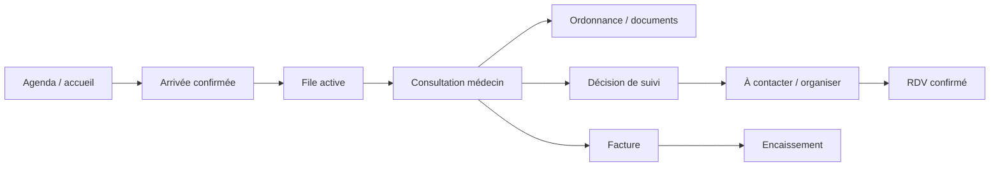

# 3. Modules, routes et parcours

## 3.1 Inventaire des routes

Toutes les routes suivantes sont définies dans [App.tsx](../../src/App.tsx#L61). « Contrôle de rôle » décrit le code client et ne prouve pas une autorisation serveur.

| Route | Écran / objectif | Auth et rôle côté client | Sources/actions principales | Statut |
|---|---|---|---|---|
| `/login` | Connexion PIN | Publique | `auth-pin` | Implémenté, serveur non vérifié |
| `/partage-ordonnance/:token` | Consulter une ordonnance partagée | Publique, accès par token et code selon Edge Function | `SharedPrescription`, `prescription-share` | Code implémenté ; flux externe non exécuté |
| `/` | Tableau de bord de journée | Session applicative | Rendez-vous, actions rapides | Implémenté |
| `/agenda` | Agenda et présence | Session applicative, rôle non explicitement restreint dans `App.tsx` | `appointments`, check-in et présence via RPC | Implémenté, règles serveur à vérifier |
| `/file-attente` | File d’attente et arrivées | Session applicative, rôle non explicitement restreint dans `App.tsx` | `queue`, patients, factures, rendez-vous | Implémenté |
| `/suivis` | Tâches post-consultation | Médecin, secrétaire, assistant | `follow_up_tasks`, planification d’un rendez-vous | Implémenté |
| `/consultations/:queueId` | Dossier de consultation | Médecin | Queue, dossier, consultation, prescription, suivi, tarif | Implémenté |
| `/patients` | Annuaire/recherche patient | Médecin | Patients, date dernière consultation | Implémenté |
| `/patients/:id` | Dossier longitudinal | Médecin | Dossier médical, consultations, prescriptions, pièces, certificats | Implémenté, IA documentaire conditionnelle |
| `/comptabilite` | Encaissement et factures | Médecin, secrétaire, assistant | Factures, contexte et mutations d’encaissement | Implémenté |
| `/statistiques` | Indicateurs agrégés de cabinet | Médecin | Rendez-vous, revenus, factures, patients | Implémenté |
| `/parametres` | Identité, équipe, horaires, impression et système | Médecin | `settings`, logo et options de cabinet | Implémenté |
| `/modeles-prescription` | Modèles et paniers d’examens/médicaments | Médecin | Modèles, catalogues, préférences | Implémenté |
| `/actes-medicaux` | Référentiel d’actes et tarifs du cabinet | Médecin | Templates d’actes, archivage | Implémenté |
| `*` | Écran introuvable | Route de repli | Aucun | Implémenté |

Il n’y a pas de routes distinctes visibles pour création de compte, récupération de mot de passe, SaaS billing, portail administrateur, patient en libre-service ou téléconsultation.

## 3.2 Modules

| Module | Écrans / données principales | Actions et dépendances | Tests identifiés / limites |
|---|---|---|---|
| Accueil | `Index`, agenda du jour, prochain patient | Accès agenda/file et liens rapides | Pas de test écran; métriques d’utilité non mesurées |
| Agenda | `Agenda`, `appointments`, données patient, événements de présence | Créer/modifier, présence, arrivée vers la file | RPC côté serveur pour actions d’arrivée/présence; déploiement non vérifié |
| File active | `FileAttente`, `queue`, patient, facture liée | Ajouter, appeler, prioriser/réordonner, démarrer/terminer | Risque de concurrence repéré sur numéro d’ordre; voir dette |
| Patients | Annuaire, identité et recherche | Créer, modifier, supprimer, ouvrir dossier | Requêtes client directes ; protection réelle dépend de RLS |
| Dossier longitudinal | Antécédents, allergies, traitements, consultations et pièces | Modifier données, consulter historique, attacher documents | Données sensibles ; cycles de sauvegarde et scopes RLS non certifiés |
| Consultation | Motif, histoire, examen, diagnostic, plan, prix et suite | Enregistrer, finaliser atomiquement via RPC, produire ordonnance | Longue page métier ; tests E2E et tests workflow absents |
| Suivis | Contrôle, examen, orientation, chirurgie | Marquer contact/issue et organiser un RDV | L’organisation peut créer RDV via RPC; pas de mesure de taux de suivi |
| Prescription | Médicaments, biologie, imagerie, détails et modèles | Créer/modifier/supprimer, synchroniser les traitements | Synchronisation dossier séparée et avertissement utilisateur si échec |
| Allergies | Contrôle des prescriptions à partir du référentiel | Avertissements et confirmation clinique | Testé par tests unitaires de règles, pas validation médicale indépendante |
| Documents patient | Upload, consultation, suppression, lien signé, analyse | Appels `patient-documents`; stockage privé | Code de contrôle présent; accès au bucket et service distants non testés |
| Certificats | Documents structurés générés/imprimés | Génération locale ou fonction PDF selon le flux | Risque d’autorisation dans endpoint de génération à traiter |
| Partage ordonnance | Création de lien/code temporaire, audit et révocation | `prescription-share` | Migration SQL pgTAP spécifique ; fonctions non exécutées |
| Comptabilité | Factures et paiements de consultation | Contexte, encaissement, remise/statut | Comptabilité de cabinet, pas facturation SaaS |
| Statistiques | Revenus, RDV, statuts de factures, démographie agrégée | Lecture et agrégation dans UI | Échelle/performance non mesurée ; qualité des exclusions à auditer |
| Paramètres | Profil, équipe, horaires, impression, systèmes | Persisté selon hooks settings | Parcours de sauvegarde codé; rendu authentifié non vérifié |
| Rappels d’agenda | Préférences locales et alertes de rendez-vous | `AppointmentReminderContext`, `Notification`, lecture périodique des RDV | Fonctionne côté client avec session ouverte/déverrouillée et permission accordée; aucun SMS ou push serveur identifié |
| Modèles / actes | Bibliothèque de prescriptions et d’actes | Création, tarif, activation/archivage | Pas de suite de tests complète de bout en bout |
| Aide CIM-11 | Suggestions de termes cliniques via OMS | `icd11-search` | Appel externe configuré ; latence/quota et conditions OMS non vérifiés |

## 3.3 Parcours réel reconstruit : arrivée → consultation → suite → règlement

1. L’équipe crée un rendez-vous dans l’agenda ou sélectionne un rendez-vous existant.
2. À l’arrivée, le check-in passe par `check_in_appointment_with_attendance`; le code invalide ensuite le cache de la file et de l’agenda.
3. Le patient apparaît dans la file du jour. Le personnel peut appeler/prioriser; le médecin ouvre `/consultations/:queueId`.
4. La consultation charge l’entrée de file, le contexte d’accueil, le dossier médical et la consultation la plus récente.
5. Les champs de consultation sont enregistrés dans `consultations`; la clôture appelle `complete_consultation`, qui reçoit aussi les décisions de suivi.
6. Un suivi peut être à contacter/organiser; l’équipe le traite dans `/suivis` puis convertit l’organisation en rendez-vous confirmé.
7. Prescription, documents et facture ont leurs propres mutations / flux. L’encaissement est géré dans Comptabilité, avec RPC dédié selon le contexte.
8. Les hooks invalides rendent les écrans rechargés cohérents, mais le comportement concurrent/hors ligne n’est pas établi.

**Données modifiées :** `appointments`, `queue`, `consultations`, `follow_up_tasks`, `prescriptions`/items, `medical_records`, `invoices` et tables de paiements selon action. Voir [useConsultations.ts](../../src/hooks/useConsultations.ts#L188), [useFollowUpTasks.ts](../../src/hooks/useFollowUpTasks.ts#L177), [useInvoiceEncashment.ts](../../src/hooks/useInvoiceEncashment.ts).

## 3.4 Parcours et ruptures à tester

- **Première ouverture :** route login présente, mais aucune création autonome de cabinet/compte établie.
- **Erreur réseau :** PWA affiche un message hors connexion et précise que les données médicales exigent Internet; aucune queue offline robuste n’est observée.
- **Impression :** aperçu et bouton print utilisent les API navigateur; choix d’imprimante relève du dialogue système.
- **Analyse OCR :** consentement et revue humaine visibles côté UI; appel fonctionnel fournisseur non vérifié.
- **Expiration/verrouillage :** session vérifiée via `auth-pin`; test unitaire de limite de délai présent, durée côté serveur/de déconnexion reste à vérifier.
- **Accès interdit :** les routes utilisent une garde React; sans politique serveur cohérente, une garde frontend ne protège pas les données d’API.
- **Récupération compte :** non identifiée dans les routes.
- **Abonnement :** aucun parcours commercial ou de paiement récurrent identifié.

**Ruptures prioritaires :** parcours connecté complet jamais vérifié, cohérence entre données de facture/consultation en échec partiel, réseau nécessaire au dossier, gestion d’équipe et permissions à certifier.
