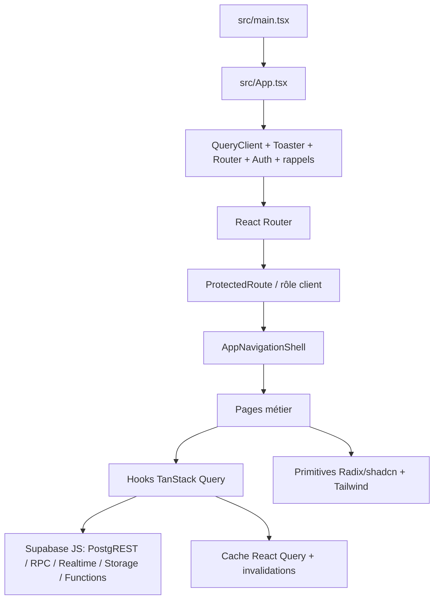

# 4. Frontend, design system et UX

## 4.1 Architecture observée

Le point de montage est [main.tsx](../../src/main.tsx). [App.tsx](../../src/App.tsx#L27) crée un `QueryClient` sans options globales explicites puis installe les fournisseurs d’auth, de rappels, de notifications et de navigation. Les composants métier appellent généralement des hooks `useQuery`/`useMutation` ; les hooks portent plusieurs règles métier et appels réseau, tandis que les pages orchestrent l’expérience.

## 4.2 Cache, chargement et erreur

- TanStack Query gère lecture, état de mutation, invalidation après succès et souvent Realtime pour file, rendez-vous et suivis.
- Les erreurs sont levées par les hooks afin que React Query expose `isError`; plusieurs mutations font toast/log.
- La cohérence Realtime est rafraîchie par invalidation globale ou ciblée, sans preuve d’isolation de canal par cabinet côté client.
- La configuration globale du `QueryClient` n’ajoute pas ici de stratégie documentée de retry, timeout ou purge lors d’un changement d’identité. Les clés de cache doivent être revues avec les transitions de session.
- Les formulaires utilisent les bibliothèques déclarées React Hook Form/Zod au sein de plusieurs modules; une validation uniforme et exhaustive n’est pas prouvée.

## 4.3 Design system

| Élément | Preuve / appréciation statique |
|---|---|
| Couleurs | Variables HSL dans [index.css](../../src/index.css#L8): fond bleu-gris clair, primaire bleu, secondaire vert, couleurs fonctionnelles et catégories patients |
| Tokens | Radius global `0.75rem`, couleurs de tuiles/santé, surfaces sidebar; alias Tailwind dans [tailwind.config.ts](../../tailwind.config.ts) |
| Composants | Radix/shadcn, Lucide React, `components.json` |
| Typographie | Pas de système de fontes métier complet établi par les extraits; vérifier rendu/fallback dans le navigateur |
| Feedback | Toast Radix et Sonner coexistent dans [App.tsx](../../src/App.tsx#L2); plusieurs hooks importent l’un ou l’autre |
| Responsive | Classes Tailwind avec breakpoints présentes sur plusieurs pages; aucune matrice testée de viewport |
| Clavier / lecteurs d’écran | `aria-label`, focus-visible, rôles et états live apparaissent dans quelques composants ; couverture globale inconnue |
| Impression | CSS dédié et formats A5/A4 dans l’écran Paramètres et l’ordonnance réelle |

## 4.4 Évaluation UX/UI statique

**Forces observables**

- Le vocabulaire métier épouse un flux quotidien concret plutôt qu’une collection de tables.
- L’agenda et la file ont des surfaces spécifiques au travail de l’équipe.
- La consultation intègre les décisions qui déterminent la suite, dont un contrôle à venir.
- Les éléments à risque (allergies, erreurs de sauvegarde, hors ligne) peuvent fournir un feedback explicite.
- Les couleurs par catégorie sont centralisées en tokens plutôt que définies uniquement par des valeurs ad hoc.

**Risques et points à contrôler visuellement**

- Le détail patient et la consultation sont volumineux : vérifier charge cognitive, scroll, orientation, raccourcis d’action et visibilité des états critiques sur écran cabinet.
- Les usages répétés de vert/bleu/rouge doivent garder un sens sémantique constant; le genre patient ne devrait pas être transmis uniquement par couleur.
- Les toasts Radix et Sonner peuvent créer deux conventions de feedback différentes.
- La limite de certains contrôles médicaux est décisive : l’interface doit distinguer alerte, contre-indication et recommandation à vérifier, et ne pas induire une décision clinique automatique.
- Les états vides, erreurs réseau, accès refusé et formulaire sauvegardé doivent être vérifiés au clavier, zoom élevé et petit écran.
- Un audit visuel, un test de contraste WCAG, une inspection des titres/noms accessibles et des sessions avec médecins/secrétaires restent nécessaires; le code seul ne permet pas de conclure sur le rendu final.

## 4.5 Recommandations UX prioritaires

1. Tester le fil d’une journée réelle avec médecin + secrétaire sur un petit écran portable et un écran desktop.
2. Réduire les allers-retours entre fiche patient, consultation, suivis et encaissement; préserver le contexte et rendre le retour prévisible.
3. Documenter une échelle d’urgence clinique avec couleur + libellé + action, jamais couleur seule.
4. Standardiser le composant et le ton des retours de mutation; distinguer action enregistrée du cache simplement actualisé.
5. Ajouter des tests automatisés de clavier et de viewport aux parcours critiques avant d’élargir le marketing.

