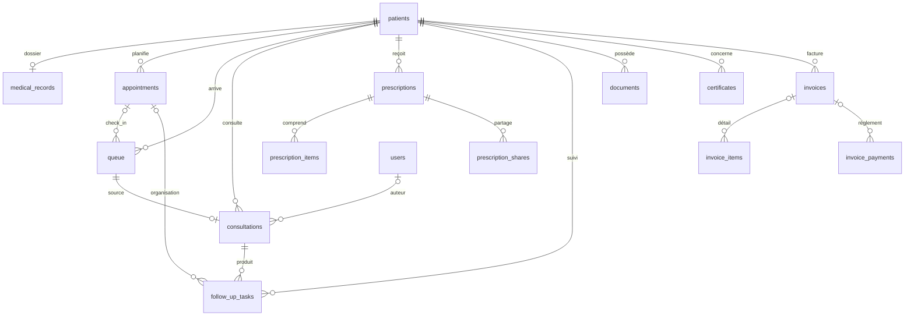

# 6. Base de données et migrations

## 6.1 Périmètre et avertissement

Les constats ci-dessous décrivent les SQL **locaux** du dépôt. Ils ne prouvent ni l’application de chaque migration ni la structure présente sur le projet Supabase distant. Aucun accès distant ni requête destructive n’a été effectué. La racine comprend 43 migrations horodatées (déc. 2025–oct. 2026), un schéma initial distinct et un script manuel de migration.

## 6.2 Tables / domaines inventoriés

| Domaine/table | Rôle | Relations locales visibles | Données sensibles |
|---|---|---|---|
| `patients` | Identité et contacts | Racine des rendez-vous, queue, dossier, prescriptions, factures, documents | Identité, coordonnées, CIN potentiel |
| `medical_records` | Antécédents, allergies, traitements, notes | Unique patient | Très sensibles |
| `appointments` | Agenda et présence | Patient, queue optionnelle | Parcours de santé, date et motif |
| `queue` | Arrivée, ordre, état de consultation, montant | Patient, appointment optionnel, invoice | Motif, événements, montant |
| `consultations` | Notes cliniques structurées | Patient et queue | Données de santé hautement sensibles |
| `prescriptions` | Ordonnances et demandes | Patient, items | Médicaments, diagnostic/indication |
| `prescription_items` | Médicament/examen, posologie, modalités | Prescription | Données cliniques et thérapeutiques |
| `follow_up_tasks` | Contrôle/exam/orientation/chirurgie à organiser | Patient, consultation, appointment optionnel | Indication et suite de soins |
| `documents` | Métadonnées de pièces | Patient, objet Storage privé | Métadonnées cliniques; fichier souvent très sensible |
| `certificates` | Certificats | Patient | Santé et identité |
| `invoices`, `invoice_items`, `invoice_payments` | Facturation et règlements du cabinet | Patient, queue selon évolution | Financier et potentiellement clinique |
| `users`, `user_sessions` / équivalents | Personnel et authentification applicative | Créateur/acteur dans plusieurs domaines | Identifiants/session |
| Tables d’événements | Présence, accueil, priorités, partage/audit | Appointments, queue, prescription/user selon table | Événements d’activité et parfois contexte médical |
| `medical_act_templates` | Catalogue de tarifs/actes du cabinet | Indépendant ou liés au cabinet | Données métier |
| `clinical_terms` et données de catalogue | Recherche/termes médicaux | Référentiel | Référentiel clinique |

Le catalogue de médicaments est interrogé par le frontend (`medications`), mais aucun `CREATE TABLE public.medications` n’a été identifié dans le périmètre des migrations examiné. C’est un écart à clarifier entre schéma, données de référence et provisionnement.

## 6.3 Schéma relationnel textuel

Le diagramme résume des liens déclarés localement; cardinalités précises et comportement au `DELETE` varient selon les migrations et doivent être confirmés dans les définitions complètes avant toute évolution.

## 6.4 Migrations, sécurité SQL et cohérence

- [supabase-schema.sql](../../supabase-schema.sql) définit des tables de base et des politiques RLS permissives `FOR ALL USING (true)` dans les lignes 64–75.
- [20261008184807_lock_down_public_clinical_tables.sql](../../supabase/migrations/20261008184807_lock_down_public_clinical_tables.sql#L1) supprime des politiques ouvertes et révoque des accès anonymes.
- [20261008185502_restore_prototype_open_access.sql](../../supabase/migrations/20261008185502_restore_prototype_open_access.sql#L1) rétablit ensuite des droits CRUD `anon` et politiques non restreintes pour plusieurs tables cliniques. Le SQL l’indique comme accès de prototype; ce statut ne réduit pas le risque si ce fichier est appliqué.
- Les migrations ultérieures améliorent notamment les documents et le partage sécurisé, sans renverser selon l’analyse effectuée la réouverture des tables cliniques.
- [manual_apply_follow_up_migrations.sql](../../supabase/manual_apply_follow_up_migrations.sql#L1) regroupe des migrations à appliquer manuellement et refuse de s’exécuter si les versions sont déjà enregistrées.
- Les migrations principales et le schéma initial ne forment pas un historique auto-suffisant évident : déterminer quel processus initialise le schéma et comment la séquence est appliquée.

## 6.5 Intégrité, concurrence et évolutions

**Risques observés / plausibles**

- Numéro d’ordre en file obtenu par « lire le maximum puis +1 » depuis le client dans [useQueue.ts](../../src/hooks/useQueue.ts#L249); deux insertions simultanées peuvent calculer le même rang si aucune contrainte/transaction serveur ne les séquence.
- Plusieurs opérations client composées en étapes (création ordonnance/items puis nettoyage de compensation; synchronisation des médicaments séparée) peuvent laisser un état partiel en cas de panne.
- La cohérence d’identifiants uniques, contraintes, index, cascades, triggers et les conflits de versions n’a pas été synthétisée exhaustivement pour chaque table; utiliser les migrations avant de changer le modèle.
- Un changement d’architecture multi-cabinet nécessitera une clé cabinet explicite et des contraintes/politiques vérifiées sur toutes les tables reliées, sauf preuve qu’un autre mécanisme couvre déjà le cloisonnement.

**Recommandation :** construire un inventaire canonique généré depuis les migrations, comparer en staging aux catalogues Postgres, appliquer les migrations dans un clone de test, vérifier RLS et exécuter pgTAP avant toute intervention sur production.

