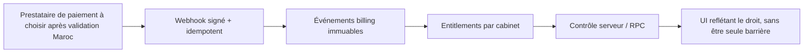

# 9. Abonnements, Premium et croissance

## 9.1 État actuel

| Capacité | État trouvé |
|---|---|
| Tarifs consultation/actes et encaissement | Présents; concernent la comptabilité du cabinet |
| Factures patient, remises, soldes | Présents dans les tables/hooks métier |
| Plans SaaS par cabinet | Aucun flux/configuration repéré |
| Essai gratuit / souscription / renouvellement | Non identifiés |
| Paiement récurrent / prestataire de paiement | Non identifié |
| Entitlements, quotas ou feature flags commerciaux | Non identifiés dans le périmètre |
| Analytics acquisition et conversion | Aucune configuration identifiée |
| Page tarifs / demande démo publique | Non identifiée par les routes |
| Onboarding public d’inscription | Non établi; écran login PIN présent |

La facturation des consultations ne doit pas être confondue avec la monétisation SaaS. Les termes *Premium* ou plans non trouvés ne permettent pas de conclure qu’une offre ne pourrait exister hors dépôt, seulement qu’elle n’y est pas démontrée.

## 9.2 Architecture commerciale cible (proposition, non existante)

- Entité `organization/clinic` porte le contrat, les sièges, le plan et les états de facturation; utilisateurs et patients sont rattachés à un cabinet.
- Service d’entitlements central, contrôlé côté serveur à chaque capacité protégée; le frontend ne masque que les affordances.
- Webhook signé avec vérification d’horodatage et idempotence; événements métier append-only, rapprochement et retries.
- Modèle de plan versionné, périodes d’essai, changements de forfait, annulation et suspension grâce à états explicites.
- Aucun prestataire n’est recommandé avant validation des paiements récurrents disponibles au Maroc, devises, règles fiscales, remboursement, facturation, encaissement, transfert et traitement de données.

## 9.3 Positionnement produit et croissance

### Positionnement recommandé

**Promesse de travail :** « La journée de votre cabinet, coordonnée de l’accueil au suivi. »

Le différenciateur potentiel n’est pas « une fiche patient de plus », ni une IA médicale : c’est le passage continu entre accueil, file, clinique, documents, suite de soins et paiement. Il faut étayer cette promesse par des mesures de pilote :

- temps moyen d’accueil → consultation;
- part des consultations dont la décision de suite est explicite;
- suivis organisés avant échéance;
- temps nécessaire à retrouver une consultation/ordonnance;
- taux de document généré correctement au premier essai;
- fréquence d’actions non enregistrées ou de doublons.

### Compétition et angle Maroc

Les pages consultées de [DabaDoc](https://www.dabadoc.com/ma) et [Med.ma](https://www.med.ma/) affichent des promesses d’annuaire et/ou de prise de rendez-vous; la profondeur d’un éventuel logiciel cabinet n’a pas été vérifiée. Shifalyx peut se présenter comme outil opérationnel complémentaire, et tester des ponts d’import/synchronisation plutôt que prétendre remplacer l’acquisition patient.

À valider par entretiens terrain au Maroc : préférence FR/arabe, usage de WhatsApp (sans y envoyer de données de santé par défaut), réseau/partage de connexion, imprimantes et formats, processus d’accueil, secrétariat partagé, mode de tarification et exigences de confiance/données.

## 9.4 Entonnoir de croissance cible

1. **Acquisition :** site de marque distinct de l’application, démonstration sans données réelles, messages par spécialité.
2. **Conversion :** essai guidé dans une sandbox avec patients synthétiques; pas d’import clinique avant validations de sécurité.
3. **Activation :** configuration du cabinet, horaires, acte, première journée simulée et modèle d’ordonnance.
4. **Abonnement :** formule expliquée avec limites et conditions, facturation locale à définir.
5. **Fidélisation :** accompagnement, indicateurs agrégés opt-in, formation sans contenu patient.
6. **Réactivation :** relance administrative déconnectée des données médicales.

Analytics marketing doit rester isolé des tables cliniques : aucun nom, identifiant, ordonnance, symptôme ou texte clinique dans événements ou paramètres publicitaires; consentement/notice à concevoir selon les obligations applicables.

