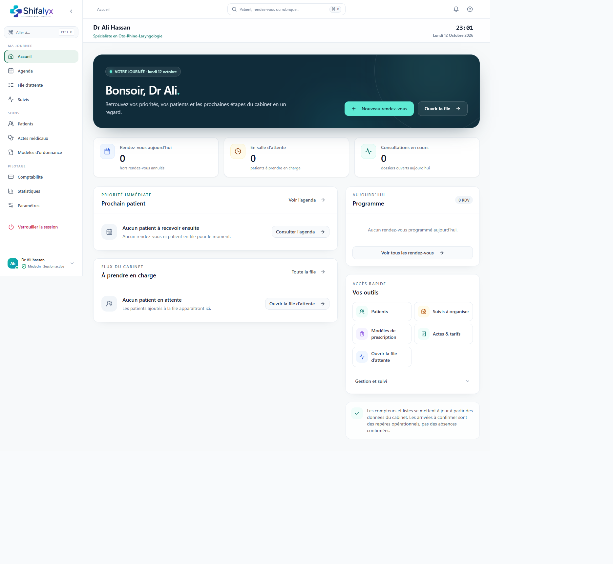

# 1. Démarrer et se repérer

## Se connecter

1. Ouvrez l’adresse Shifalyx qui vous a été communiquée par votre cabinet.
2. Sur l’écran d’accès, choisissez votre profil si plusieurs profils sont proposés.
3. Saisissez votre code PIN pour ouvrir la session.
4. Vérifiez le nom du profil affiché dans la navigation avant de consulter ou modifier un dossier.

Si la liste des profils ou l’écran de connexion affiche une erreur, consultez [Connexion, sécurité et dépannage](./13-connexion-securite-depannage.md). Ne tentez pas de contourner l’accès par une URL directe.

## Navigation principale

La navigation latérale regroupe les pages en trois ensembles :

| Groupe | Pages | Usage |
|---|---|---|
| Ma journée | Accueil (selon rôle), Agenda, File d’attente, Suivis | Coordonner rendez-vous, arrivées et prochaines étapes |
| Soins | Patients, Actes médicaux, Modèles d’ordonnance | Dossiers et préparation des documents médicaux (rôle médecin) |
| Pilotage | Comptabilité, Statistiques, Paramètres | Encaissements, activité et configuration (accès selon rôle) |

Sur mobile, une navigation compacte affiche les pages principales adaptées au rôle. Les écrans Consultation et Dossier patient s’ouvrent depuis les flux de travail plutôt que comme entrées principales.

## Recherche et raccourcis

- **Aller à…** ouvre la navigation rapide vers les rubriques disponibles.
- La recherche globale du shell peut retrouver des patients selon les données auxquelles le rôle a accès. Vérifiez toujours la fiche sélectionnée avant d’agir.
- Un raccourci clavier est affiché dans l’interface quand il est disponible; ses touches peuvent varier selon OS/navigateur.
- L’aide contextuelle accessible depuis l’icône d’aide dépend de la version affichée.

## Repères visuels

- Les badges et libellés donnent le statut de l’objet; ne vous fiez pas uniquement à la couleur.
- Les messages de chargement signifient que les données ne sont pas encore disponibles.
- Une erreur de chargement n’équivaut pas à un résultat vide : utilisez « Réessayer » si le bouton est proposé.
- Dans les modules avec sauvegarde explicite, attendez la confirmation d’enregistrement avant de quitter.

## Verrouiller et quitter la session

Utilisez **Verrouiller la session** quand le poste est laissé sans surveillance. Verrouiller n’est pas la même action que fermer la fenêtre. Après verrouillage, un déverrouillage via PIN est requis.

