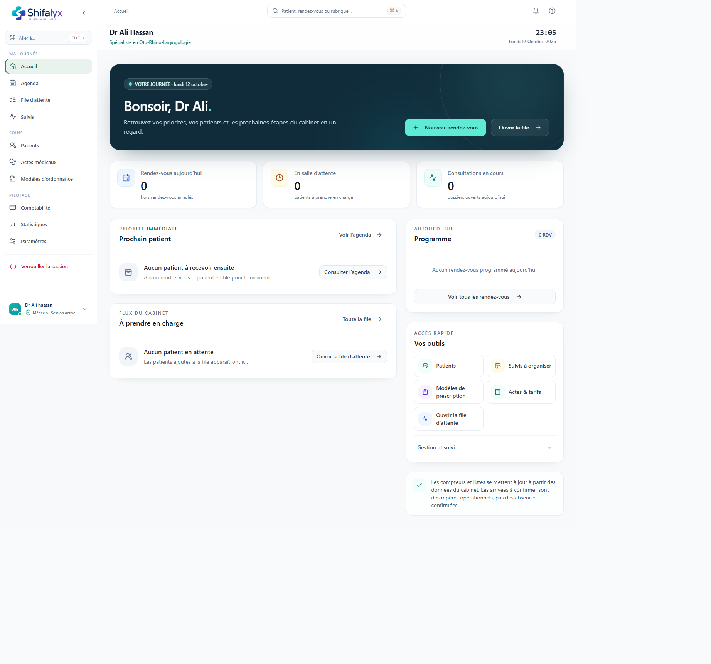

# 2. Accueil et organisation de la journée

## Tableau de bord

L’accueil fournit une vue synthétique de l’activité du jour et des raccourcis. Selon la configuration et les données disponibles, il peut présenter :

- le nombre de rendez-vous du jour;
- le nombre de patients en attente;
- les consultations en cours;
- le prochain patient ou l’absence de prise en charge suivante;
- le programme des rendez-vous;
- des accès rapides vers agenda, file, patients, suivis, comptabilité, statistiques, actes et modèles.

Les chiffres sont calculés depuis les données chargées. Si un indicateur affiche un tiret, une animation de chargement ou un message d’erreur, ne le traitez pas comme un zéro.

## Routines suggérées

### Avant l’ouverture

1. Consultez l’Agenda du jour et vérifiez les rendez-vous à confirmer.
2. Repérez les retards et les rendez-vous déjà arrivés.
3. Ouvrez les Suivis pour voir les tâches à organiser et les échéances dépassées.
4. Consultez le résumé « À encaisser aujourd’hui » si cette fonction est disponible pour votre rôle.

### Pendant la journée

1. Confirmez l’arrivée depuis le rendez-vous ou ajoutez la personne à la file selon le processus du cabinet.
2. Appelez le patient depuis la file et vérifiez la bonne entrée avant de démarrer une consultation.
3. Traitez les tâches d’accueil et d’encaissement depuis leurs vues dédiées.

### À la clôture

1. Vérifiez les patients encore en attente, appelés ou en consultation.
2. Vérifiez que les consultations ouvertes sont enregistrées ou terminées selon le processus médical.
3. Organisez les suivis qui restent à contacter.
4. Vérifiez les règlements différés ou soldes signalés par la comptabilité.

Ce sont des repères d’organisation, pas une clôture de journée automatisée. L’application ne certifie pas que toutes les actions métier ont été accomplies.

## Transitions importantes

Le flux principal observé est :

`Agenda → arrivée confirmée → File d’attente → Consultation → Documents / suivi → Comptabilité`

Un suivi recommandé n’est pas encore un rendez-vous confirmé. Le suivi rejoint l’agenda uniquement après organisation/confirmation.

