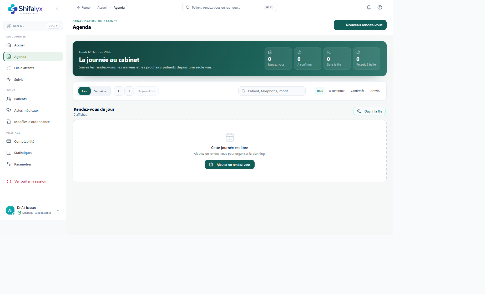
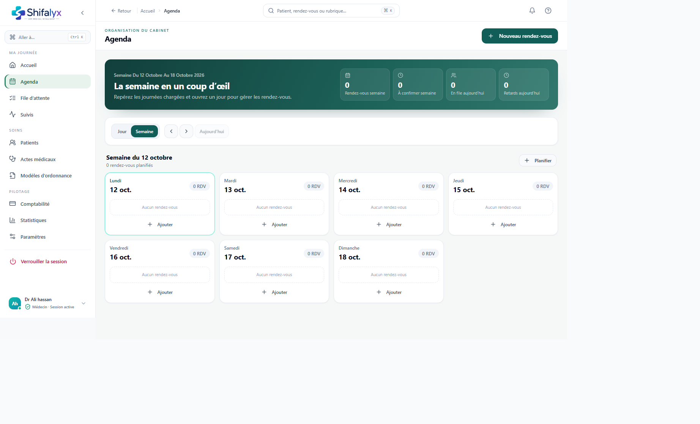
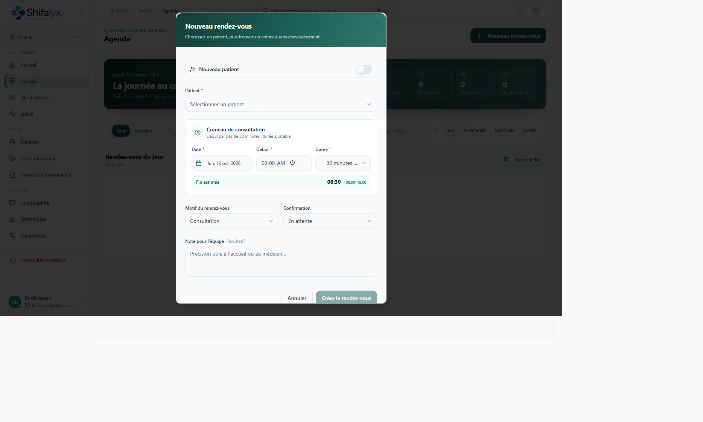

# 3. Agenda et rendez-vous

## Ouvrir la journée ou la semaine

1. Dans **Agenda**, utilisez l’onglet **Jour** pour gérer une journée ou **Semaine** pour repérer les créneaux chargés.
2. Les boutons précédent/suivant déplacent la période affichée.
3. **Aujourd’hui** revient à la date actuelle.
4. En vue Jour, recherchez par patient, téléphone ou motif et filtrez les rendez-vous : Tous, À confirmer, Confirmés ou Arrivés.

Les filtres changent la liste affichée, pas le statut réel du rendez-vous.

## Créer un rendez-vous

1. Cliquez sur **Nouveau rendez-vous**.
2. Sélectionnez ou recherchez le patient.
3. Renseignez la date, l’heure et les détails requis dans la fenêtre.
4. Vérifiez le type, le statut, la durée et les notes.
5. Enregistrez puis confirmez visuellement que le rendez-vous apparaît au bon jour et à la bonne heure.

La durée par défaut et les jours d’ouverture peuvent dépendre des réglages du cabinet. Si un créneau est refusé ou chevauche un autre rendez-vous, choisissez une autre période plutôt que de forcer.

## Modifier ou annuler

- Ouvrez le rendez-vous voulu, vérifiez le patient, puis utilisez l’action de modification.
- Après une modification, contrôlez date, heure et statut dans la liste.
- Pour supprimer ou annuler, privilégiez le statut d’annulation lorsque le workflow le propose afin de conserver un historique opérationnel.
- Si l’action échoue, actualisez la page et vérifiez le statut avant de la répéter.

## Présence et arrivée

Le rendez-vous peut afficher des états de présence (attendu, arrivé, en retard/à recontacter, absent ou annulé selon les actions disponibles).

- **Arrivée confirmée** ajoute le patient à la file active via une action métier.
- Les actions de retard et absence enregistrent une décision/une note lorsqu’elles sont proposées.
- L’arrivée à la clinique et le statut « confirmé » d’un rendez-vous ne sont pas la même chose.
- Après l’arrivée, vérifiez la file pour éviter de créer une seconde entrée manuelle.

## Appeler un patient

Quand un numéro est disponible, une action d’appel peut ouvrir l’application téléphonique de l’appareil. Shifalyx ne passe pas nécessairement l’appel lui-même. Vérifiez le numéro et respectez les règles du cabinet.

