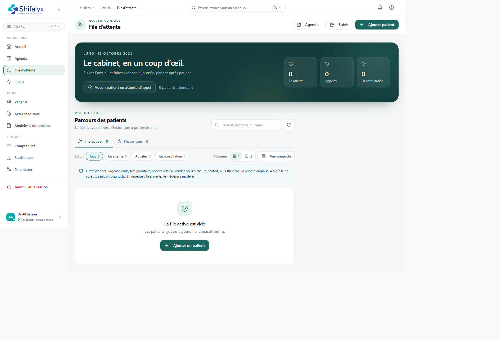

# 4. File d’attente et accueil des patients

## Lire la file

La page File d’attente présente les patients du jour et les volumes par état. Les vues peuvent inclure :

- les patients en attente;
- les patients appelés;
- les consultations en cours;
- les rendez-vous du jour et leurs arrivées;
- les soldes à encaisser (pour les profils autorisés);
- des filtres de statut et de recherche;
- un affichage compact/détaillé et une ou deux colonnes.

Utilisez la recherche puis confirmez l’identité avant d’actionner une entrée. Ne choisissez pas uniquement par rang si plusieurs patients ont des noms proches.

## Ajouter une personne à la file

1. Recherchez le patient existant ou utilisez le parcours de création de patient selon les règles du cabinet.
2. Sélectionnez le patient correspondant.
3. Renseignez le motif ou les informations demandées.
4. Vérifiez le montant de consultation si l’interface le demande.
5. Ajoutez à la file et confirmez que l’entrée apparaît pour la journée.

Pour une personne qui a déjà un rendez-vous, préférez l’action d’arrivée sur le rendez-vous afin que le lien reste cohérent et évitez de doubler l’entrée.

## Appeler et faire avancer

- **Appeler le suivant** ou l’action d’appel sur une entrée notifie le statut d’appel. Selon l’appareil, un appel téléphonique peut ouvrir le composeur.
- L’action de démarrage ouvre le contexte de consultation réservé au médecin.
- Les actions de retour en attente, fin ou retrait de file modifient le statut. Relisez la confirmation et vérifiez l’état après l’action.
- L’ordre manuel ne concerne que les patients du groupe de priorité correspondant lorsque cette règle est indiquée. N’utilisez pas le tri manuel pour contourner une priorité clinique.

## Synthèse avant consultation

Une synthèse préconsultation peut afficher des éléments pertinents du dossier à l’accueil. Elle sert à préparer l’échange; elle ne remplace ni l’examen du médecin ni le dossier complet.

## Encaissement depuis la file

Une section de suivi des montants peut afficher des soldes patient/organisme et proposer l’ouverture du dialogue de règlement. Contrôlez le montant, le payeur et le mode avant de confirmer. La page Comptabilité explique plus précisément le flux.

## Si un patient apparaît deux fois

N’effectuez pas immédiatement une suppression. Vérifiez d’abord s’il s’agit d’un rendez-vous arrivé et d’une entrée ajoutée manuellement, puis suivez la procédure du cabinet. Les changements de file peuvent affecter l’historique.

Les états préconsultation et encaissement ne sont pas illustrés : aucune entrée n’était présente dans la file et aucune opération n’a été créée pour les besoins de la documentation.
