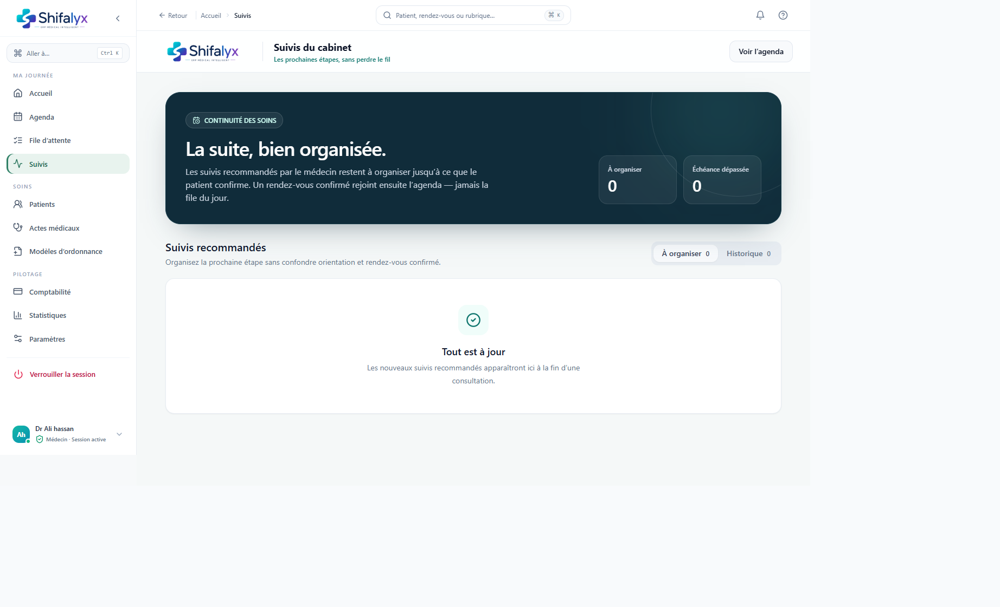
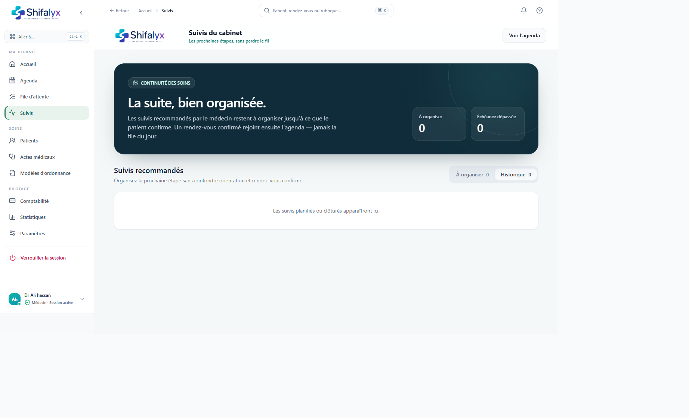

# 5. Suivis et prochaines étapes

## Ce qu’est un suivi

Un suivi est une prochaine étape recommandée lors de la consultation (contrôle, examen, orientation ou chirurgie selon le choix clinique). Il apparaît dans **Suivis** comme tâche à organiser. Il ne constitue pas une confirmation de rendez-vous.

## Ouvrir et filtrer

1. Ouvrez **Suivis**.
2. L’onglet **À organiser** présente les tâches actives.
3. L’onglet **Historique** présente les tâches qui ne sont plus en cours.
4. Examinez le type, l’échéance, la consigne et le contexte avant de contacter le patient.
5. Les indicateurs **À organiser** et **Échéance dépassée** aident au tri, mais ne remplacent pas une vérification du dossier.

## Contacter et enregistrer une issue

Selon le dialogue disponible, l’équipe peut :

- planifier un rendez-vous;
- indiquer que le patient est injoignable / à rappeler;
- indiquer que le patient a refusé la suite;
- marquer la suite comme organisée.

Choisissez l’issue qui correspond réellement à l’échange. Ne marquez pas « organisée » tant que la prochaine étape n’est pas convenue. Les actions changent l’historique du suivi.

## Planifier le rendez-vous

1. Ouvrez l’action de planification depuis le suivi.
2. Choisissez une date et des heures proposées.
3. Vérifiez que le créneau convient à l’agenda.
4. Enregistrez.
5. Vérifiez que l’agenda contient le rendez-vous et que le suivi apparaît comme organisé.

En cas d’erreur, le message de l’application indique que le suivi reste à organiser : vérifiez-le avant de recommencer. Un rendez-vous créé ici rejoint l’agenda, pas la file active.

## Bonnes pratiques

- Respecter l’échéance clinique et les consignes du médecin.
- Utiliser les coordonnées selon les règles de confidentialité du cabinet.
- Ne pas mettre d’informations médicales détaillées dans une note d’appel si elles ne sont pas nécessaires.
- Après un message vocal ou une tentative infructueuse, conserver l’issue exacte et la prochaine action.

Le dialogue de planification n’est pas capturé : aucun suivi actif n’était disponible et aucun rendez-vous n’a été créé pour produire une illustration.
