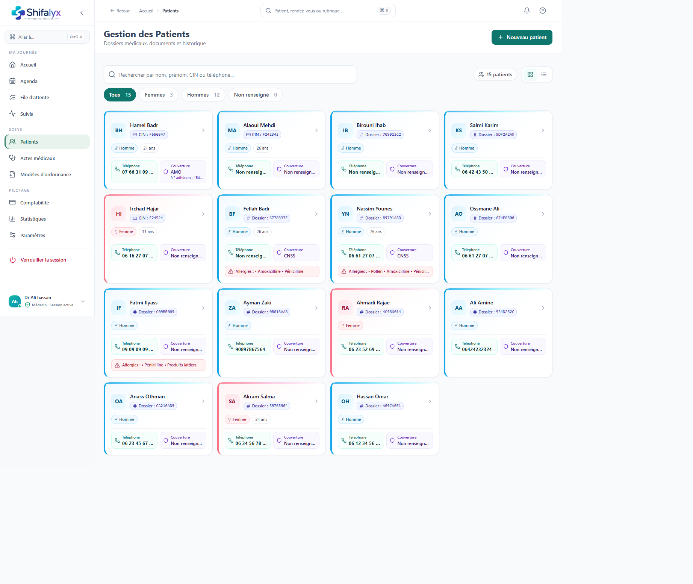
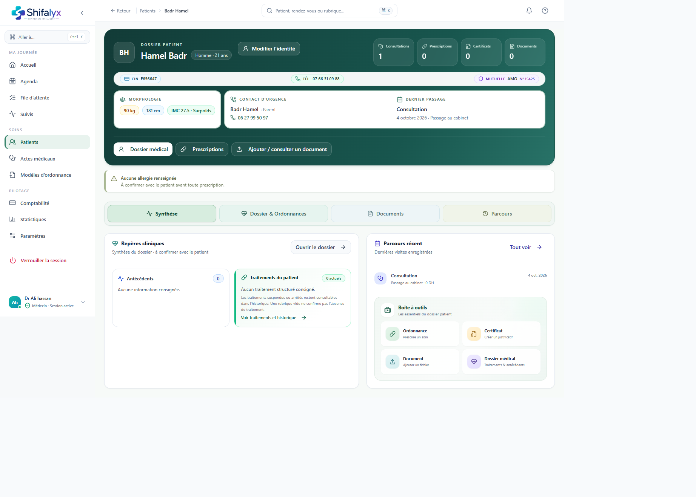
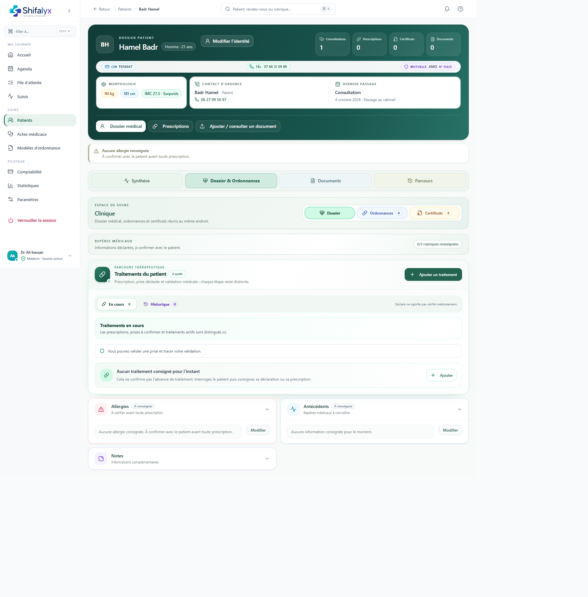
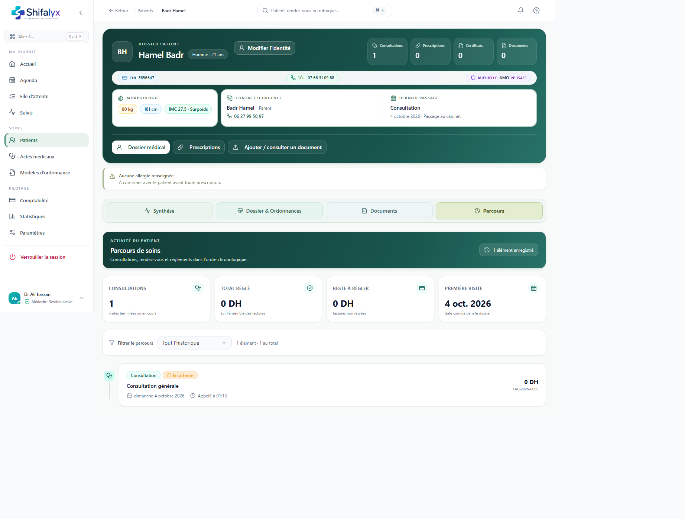

# 6. Patients et dossiers

## Rechercher dans l’annuaire

1. Ouvrez **Patients**.
2. Recherchez avec le nom, le téléphone ou l’identifiant proposé.
3. Vérifiez le nom complet et les renseignements affichés avant d’ouvrir la fiche.
4. Utilisez les filtres de statut pour réduire la liste.

La recherche n’est pas un contrôle d’identité. Si les résultats sont ambigus, vérifiez directement avec la personne et les procédures du cabinet.

## Créer une fiche

1. Sélectionnez **Nouveau patient**.
2. Saisissez les renseignements nécessaires et autorisés par le cabinet.
3. Vérifiez orthographe, coordonnées et champs obligatoires.
4. Enregistrez et ouvrez la fiche créée pour confirmer qu’elle est complète.

Ne créez pas de doublon pour contourner une fiche verrouillée ou une erreur de recherche. Recherchez d’abord par plusieurs critères. Toute création doit respecter les règles de confidentialité et de qualité des données.

## Comprendre la fiche

La fiche regroupe des éléments en onglets :

- **Vue d’ensemble :** résumé clinique et administratif du patient.
- **Antécédents :** renseignements médicaux consignés dans le dossier.
- **Allergies :** allergies signalées/consignées et avertissements associés.
- **Consultations :** historique clinique.
- **Documents :** documents liés à la fiche, selon les permissions.
- **Résumé clinique :** éléments structurés du dossier.
- **Ordonnances :** prescriptions enregistrées.
- **Certificats :** certificats associés au dossier.
- **Imagerie :** informations ou documents d’imagerie, si présents.
- **Rendez-vous :** historique et prochaines visites.
- **Finances :** règlements et soldes visibles selon rôle.
- **Journal :** événements du dossier lorsque disponible.

L’absence d’une entrée peut signifier qu’aucune donnée n’a été enregistrée dans cette section; elle ne confirme pas à elle seule une absence médicale.

## Modifier les informations

Utilisez l’action d’édition de la section visée. Vérifiez les données puis enregistrez. Après sauvegarde, relisez la valeur dans la fiche. Certaines informations cliniques peuvent être réservées au médecin ou nécessiter une validation.

## Favoris et navigation retour

Les favoris peuvent épingler des patients pour un accès rapide. Un favori est une aide à la navigation, pas un signal de priorité clinique. Utilisez le retour vers les patients lorsque vous quittez le détail.

