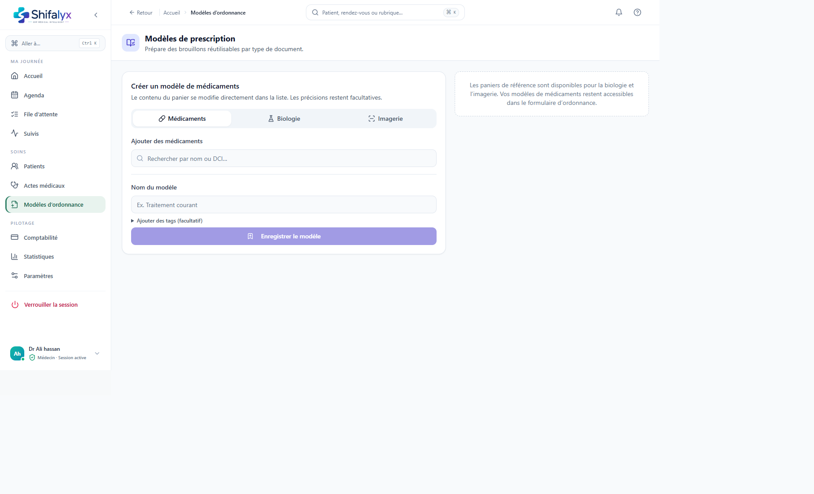

# 8. Ordonnances et modèles

## Créer une ordonnance pendant la consultation

1. Ouvrez la partie médicaments/ordonnance depuis le parcours de consultation.
2. Recherchez et sélectionnez le médicament dans le catalogue disponible.
3. Vérifiez dosage, forme, voie, fréquence, durée et instructions avant de confirmer.
4. Ajoutez les médicaments nécessaires.
5. Relisez l’aperçu complet et corrigez toute information avant d’enregistrer ou d’imprimer.

L’interface ne remplace pas le contrôle clinique de la prescription. Elle ne garantit ni disponibilité ni remboursement par une pharmacie ou un organisme.

## Modèles de prescription

La page **Modèles d’ordonnance** permet de retrouver les modèles enregistrés et d’en créer/modifier selon les droits.

- Un modèle accélère la saisie, mais son contenu doit être vérifié pour chaque patient.
- Contrôlez que les instructions enregistrées sont toujours adaptées.
- Ne modifiez pas un modèle partagé sans vérifier son impact pour les autres utilisateurs.
- Vérifiez le statut actif, les catégories et les informations d’impression disponibles.

## Imprimer

La fenêtre d’impression est celle du navigateur/système. Sélectionnez l’imprimante dans cette fenêtre, puis contrôlez papier, orientation, marges et échelle. Shifalyx ne choisit pas à votre place une imprimante spécifique.

La page **Paramètres → Impression** propose un choix A5/A4 et un test qui imprime une ordonnance de démonstration correspondante. Le document test n’est pas un document patient. Vérifiez le format papier chargé et évitez une mise à l’échelle automatique qui rendrait les dimensions incohérentes.

Les captures d’édition et d’aperçu d’une ordonnance patient restent à réaliser; aucune prescription patient n’a été créée pour la documentation.
