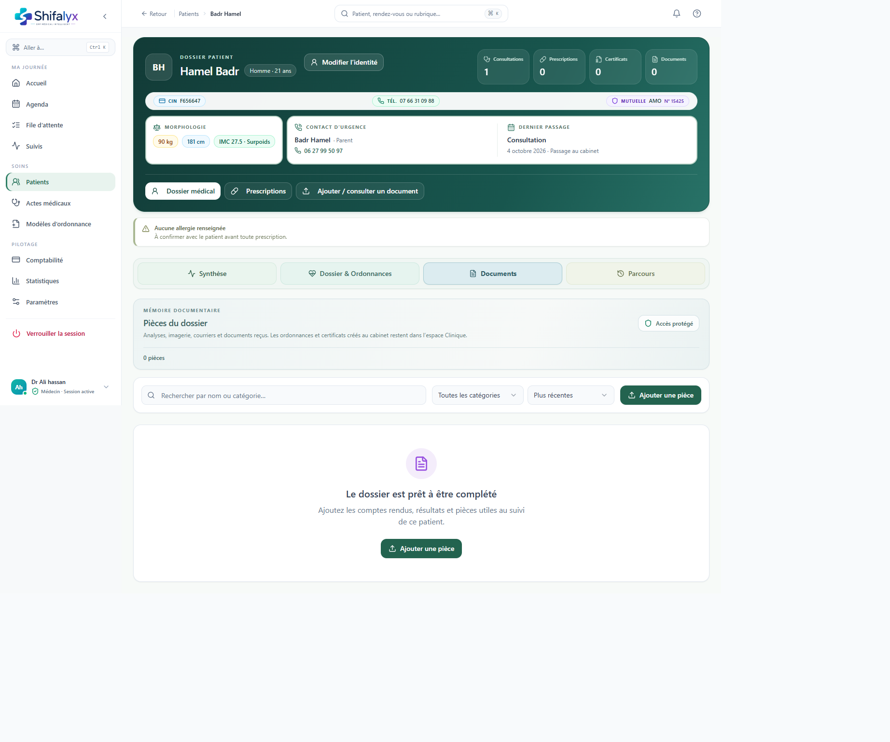

# 9. Documents, certificats et partage

## Documents du dossier

Depuis le dossier patient, ouvrez **Documents** pour voir les pièces associées. Vérifiez l’identité du patient, la nature et la date du document avant l’ouverture, le téléchargement ou le partage.

Les formats proposés et droits d’accès dépendent du document et du profil. Si l’aperçu échoue, n’envoyez pas le document depuis une copie locale non vérifiée.

## Certificats

Les certificats sont accessibles depuis le dossier et/ou le parcours de consultation selon la version. Avant impression ou téléchargement :

1. vérifiez identité et date;
2. relisez le contenu;
3. vérifiez qu’il s’agit du bon type de document;
4. confirmez qu’il est finalisé.

Le médecin demeure responsable du contenu clinique et de la décision d’émettre un certificat.

## Partage sécurisé d’une ordonnance

Le parcours de partage peut générer un lien sécurisé permettant au destinataire d’afficher une ordonnance et d’en télécharger ou imprimer une copie.

- Utilisez les actions de partage de Shifalyx plutôt qu’un lien copié depuis l’adresse du navigateur.
- Vérifiez le document, le patient et le destinataire avant l’envoi.
- Un lien temporaire peut expirer ou être révoqué; transmettez-le par un canal approprié.
- Ne partagez pas d’URL dans un espace public ou une conversation non destinée au patient.
- Confirmez que le destinataire a reçu le lien sans révéler d’autres données du dossier.

Le partage numérique n’est pas un envoi automatique à une pharmacie, à un organisme ou au patient, sauf indication explicite dans le flux affiché.

Les vues de certificat et de partage sécurisé restent à réaliser : elles nécessitent un document disponible et n’ont pas été fabriquées pour la capture.
