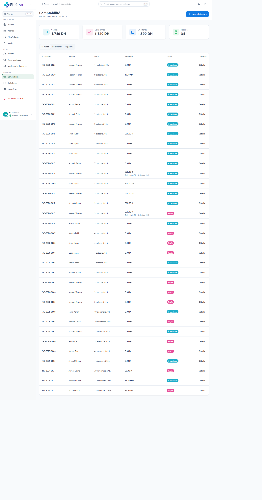

# 10. Comptabilité et encaissements

## Vue comptabilité

La page **Comptabilité** rassemble les encaissements et éléments de suivi financier accessibles au profil. Consultez les filtres et périodes affichés avant de tirer une conclusion sur les montants.

## Enregistrer un règlement

Le règlement peut être lancé depuis la comptabilité, le dossier patient ou la file selon le profil.

1. Ouvrez le patient et vérifiez le solde dû.
2. Contrôlez le payeur (patient ou organisme) et le montant à régler.
3. Sélectionnez le mode de paiement réellement reçu.
4. Ajoutez une référence ou un commentaire uniquement si nécessaire.
5. Confirmez une seule fois.
6. Vérifiez l’écriture, son montant, son statut et le solde restant.

Ne répétez pas une confirmation si la réponse a expiré : actualisez et contrôlez d’abord si le paiement est déjà enregistré. Ne saisissez pas de données de carte bancaire dans un champ commentaire.

## Paiement partiel ou tiers payant

Si l’interface propose un paiement partiel ou une prise en charge organisme, vérifiez :

- le montant effectivement reçu;
- la part patient et la part organisme;
- le solde restant;
- le statut de chaque élément.

La prise en charge indiquée ne signifie pas qu’un organisme a effectivement versé le montant.

## Factures, reçus et historique

Ouvrez l’écriture correspondante pour consulter les détails disponibles et imprimer/télécharger un reçu si la fonction est proposée. Vérifiez date, patient, montant et mode. Toute correction doit suivre le processus de régularisation prévu par le cabinet.

## Rapprochement de fin de journée

Comparez les écritures affichées à la période sélectionnée avec les reçus et moyens de paiement réels du cabinet. L’application fournit un suivi mais ne remplace pas la comptabilité réglementaire ni la validation du responsable financier.

Les vues de saisie de règlement et de reçu ne sont pas illustrées : aucune opération financière n’a été créée pour produire les captures.
