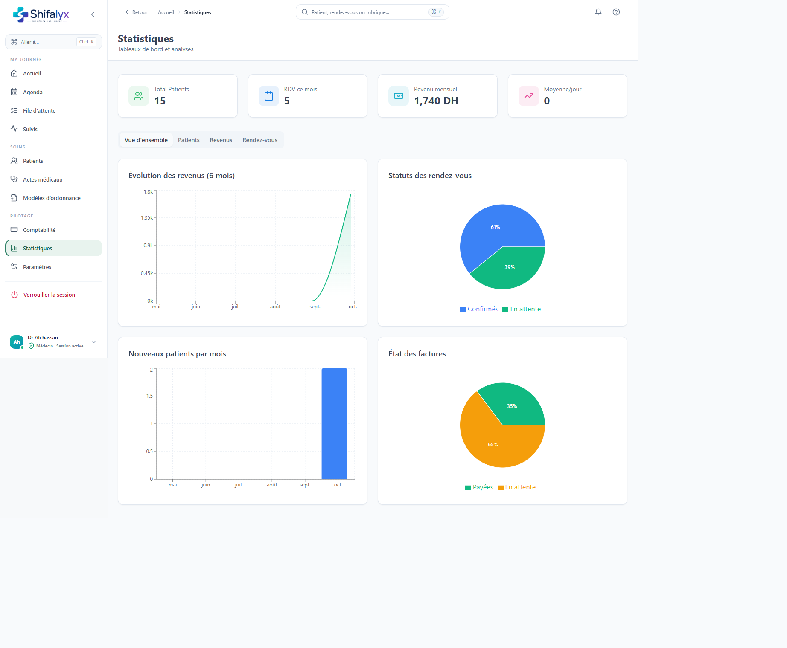

# 11. Statistiques

## Consulter les indicateurs

La page **Statistiques** présente des indicateurs d’activité et des graphiques selon la période et les filtres disponibles. Avant d’interpréter :

1. vérifiez l’intervalle de dates;
2. vérifiez les filtres actifs;
3. attendez la fin du chargement;
4. comparez les totaux à la source métier correspondante si un écart est important.

Un graphique vide peut résulter d’une période sans données ou d’un défaut de chargement. Il ne prouve pas que l’activité était nulle.

## Exporter

Si un export est disponible, choisissez la période et les filtres avant de lancer l’export. Traitez le fichier comme une donnée confidentielle, stockez-le dans l’emplacement approuvé par le cabinet et supprimez les copies inutiles.

## Limites d’interprétation

Les statistiques reflètent les données saisies et accessibles au rôle. Elles ne constituent pas une analyse médicale, comptable ou réglementaire certifiée. Les indicateurs varient selon les modules et les événements qui ont effectivement été enregistrés.

