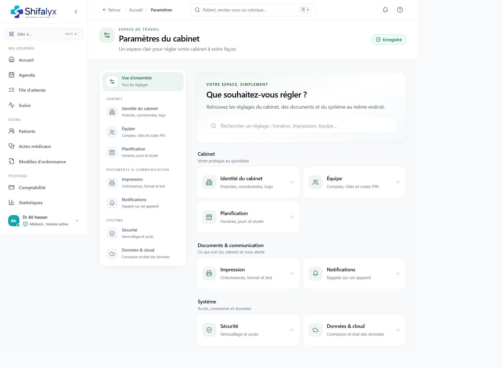
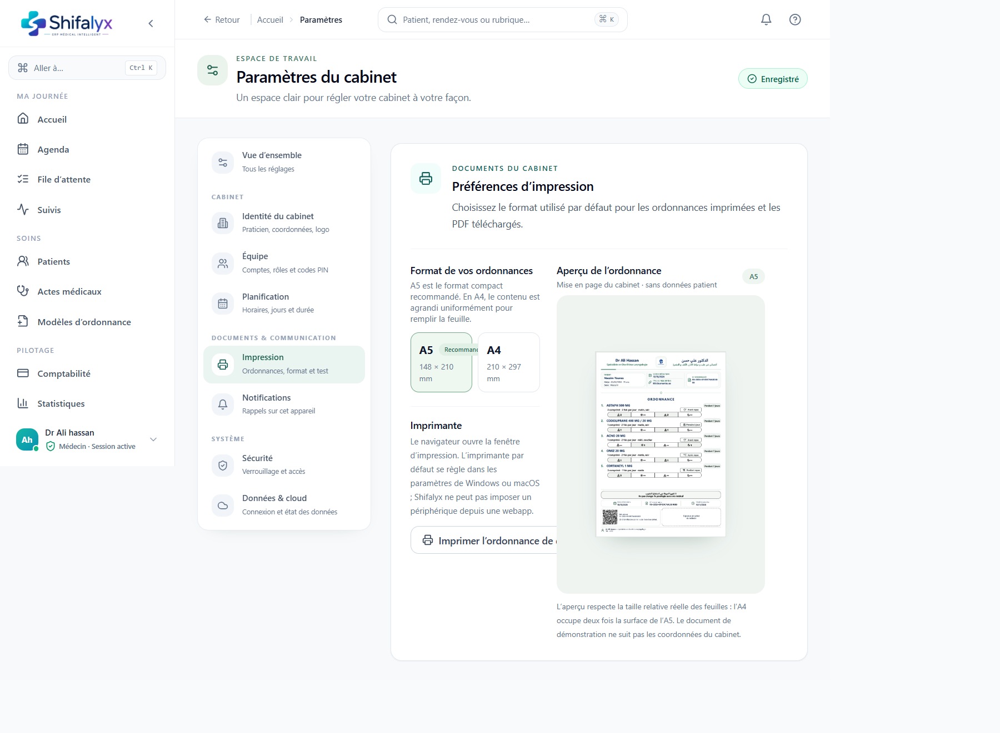

# 13. Paramètres du cabinet

## Trouver un réglage

La page d’accueil des Paramètres regroupe les rubriques en catégories Cabinet, Documents et communication, et Système. Utilisez la recherche pour retrouver un terme, puis ouvrez la rubrique correspondante.

Les options visibles dépendent du rôle. Les réglages du cabinet peuvent affecter toute l’équipe : ne modifiez pas une valeur globale sans accord du responsable.

## Cabinet

Rubriques possibles :

- **Identité du cabinet :** nom, coordonnées et éléments d’identité utilisés par les documents.
- **Équipe :** comptes, rôles et accès autorisés.
- **Planification :** horaires, jours d’ouverture, durée des rendez-vous et disponibilités.

Après une modification, vérifiez les effets sur les rendez-vous et documents concernés.

## Documents et communication

- **Impression :** format A5/A4, préférences visuelles et test d’impression.
- **Notifications :** canaux ou événements configurables selon la version.

### Tester l’impression

1. Choisissez A5 ou A4.
2. Lancez l’impression test : elle utilise l’ordonnance de démonstration.
3. Dans la boîte de dialogue native, choisissez l’imprimante et confirmez format papier, orientation et échelle.
4. Vérifiez le résultat physique avant d’imprimer des documents patient.

La sélection de l’imprimante est laissée au navigateur/système; Shifalyx ne mémorise pas nécessairement un périphérique par défaut.

## Système

- **Sécurité :** PIN, verrouillage et paramètres liés à la session, selon les droits.
- **Données :** commandes de sauvegarde/export/import si elles sont disponibles. Contrôlez les avertissements : une importation peut modifier des données.
- **Synchronisation :** état de connexion ou de mise à jour des données, si affiché.

N’effacez, n’importez ou ne restaurez jamais des données sans sauvegarde vérifiée et autorisation.

## États de sauvegarde

Sur les formulaires qui sauvegardent automatiquement :

- **Modifications en cours :** changements locaux pas encore confirmés comme persistés;
- **Enregistrement… :** sauvegarde en cours;
- **Enregistré :** confirmation affichée par l’application;
- **Erreur :** la sauvegarde n’est pas confirmée; corrigez la cause ou réessayez après contrôle.

Ne quittez pas immédiatement une page indiquant une sauvegarde en cours ou en erreur. La sauvegarde automatique ne doit pas être interprétée comme une confirmation si l’indicateur ne l’affiche pas.

L’état de sauvegarde/erreur n’est pas capturé : une erreur n’a pas été provoquée pour la documentation.
