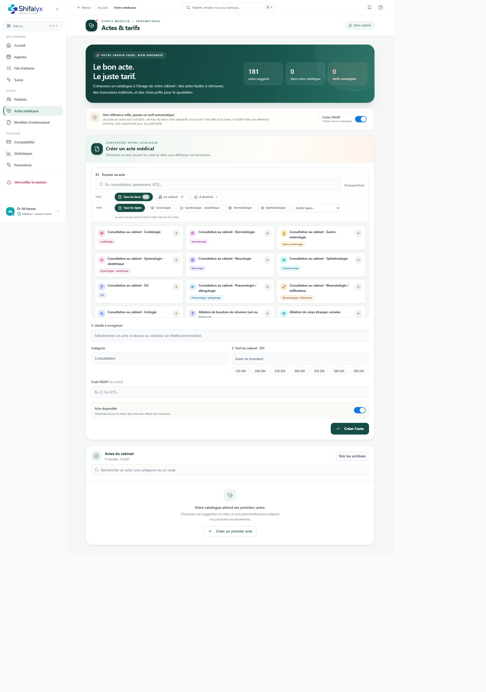

# 12. Actes médicaux et tarifs

Le catalogue **Actes & tarifs** permet au médecin de préparer les actes courants du cabinet et les honoraires associés. Il est accessible depuis la navigation principale, dans **Soins**. La page est réservée aux profils médecins.

## Comprendre les suggestions et le catalogue

La page distingue les suggestions proposées pour composer le catalogue des actes déjà enregistrés par le cabinet. Une suggestion n’est pas un acte du cabinet et ne porte pas automatiquement un tarif : elle devient une entrée du catalogue seulement après vérification et enregistrement.

1. Recherchez un acte par libellé, catégorie ou code.
2. Utilisez les filtres de lieu (**Tous les lieux**, **Au cabinet**, **À domicile**) et de type pour réduire les propositions.
3. Sélectionnez une proposition pour reprendre son libellé et sa catégorie dans le formulaire, ou saisissez un libellé personnalisé si aucune proposition ne convient.
4. Relisez les champs avant de poursuivre : la sélection seule n’enregistre rien.

Les suggestions affichées sont limitées à 30 résultats. Affinez les filtres ou la recherche si vous ne trouvez pas l’entrée souhaitée.

## Créer un acte du cabinet

Dans le formulaire **Créer un acte médical** :

1. choisissez une suggestion, ou renseignez vous-même le libellé;
2. vérifiez ou indiquez la catégorie;
3. saisissez le tarif du cabinet en dirhams, si vous souhaitez en renseigner un;
4. renseignez éventuellement un code NGAP après vérification de sa pertinence;
5. laissez l’acte disponible s’il doit apparaître parmi les actes actifs;
6. sélectionnez **Créer l’acte**, puis vérifiez qu’il apparaît dans le catalogue.

Les montants suggérés comme raccourcis sont des aides à la saisie, pas un tarif recommandé ou réglementaire. Le cabinet détermine ses honoraires. Un tarif vide reste possible; aucun tarif ne doit être déduit d’un code NGAP.

Les codes NGAP sont facultatifs et peuvent être masqués ou affichés dans le catalogue avec le réglage **Codes NGAP**. L’application précise que le code n’est pas un tarif et que la NGAP reste une référence distincte. Vérifiez le code dans la référence appropriée avant de l’utiliser, notamment pour un justificatif.

## Rechercher, modifier ou archiver

La zone **Actes du cabinet** liste les entrées enregistrées. Recherchez par acte, catégorie ou code pour retrouver une entrée. Selon son état, utilisez les commandes disponibles pour la modifier, la retirer des actes actifs ou consulter les archives.

Archiver retire un acte des choix actifs sans effacer son historique. Pour consulter les entrées archivées, ouvrez **Voir les archives**; utilisez **Voir les actes actifs** pour revenir au catalogue courant. Vérifiez l’état de l’acte après une action et tenez compte du message de confirmation ou d’erreur.

Avant d’archiver un acte, assurez-vous qu’il n’est plus nécessaire au fonctionnement courant du cabinet. Une erreur d’enregistrement ne confirme pas la modification : vérifiez l’état du catalogue avant de recommencer.

## Repères affichés

Les indicateurs résument le nombre de suggestions, d’actes du catalogue et d’actes actifs avec tarif renseigné. Ils ne constituent ni une validation réglementaire des tarifs ni un rapport comptable.

## Utiliser les actes à la clôture d’une consultation

Dans **Actes & tarification**, les chips rapides reprennent les actes actifs tarifés du catalogue **Actes & tarifs**, avec leur libellé et leur tarif configuré. Un clic ajoute l’acte à la facture. La recherche unifiée filtre aussi ce catalogue par texte; un montant saisi propose une ligne personnalisée. Sélectionnez uniquement les prestations réalisées. Les quantités et tarifs unitaires sont ajustables pour cette facture, sans changer le prix par défaut du catalogue.

- Le tarif de consultation et les actes sélectionnés sont additionnés pour former le total brut.
- La réduction éventuelle s’applique à ce total.
- Le panneau de droite regroupe la suite à prévoir, le règlement, le récapitulatif financier et la validation finale. Choisissez **À encaisser**, **Différé** ou **Gratuit**; l’équipe d’accueil voit ensuite la consigne et le solde correspondant.
- Les honoraires, actes du catalogue et prestations personnalisées sont enregistrés en lignes distinctes sur la facture. Un tarif ajusté ne modifie pas le prix par défaut du catalogue.

Un acte sans tarif n’est pas proposé dans la recherche du catalogue. Ajoutez ou vérifiez son tarif dans **Actes & tarifs** avant la clôture. La finalisation est également déclenchable avec **Ctrl/Cmd + Entrée**. Le médecin reste responsable de vérifier actes, quantités, remises et montants affichés.

La capture représente l’interface observée avec un catalogue vide. Elle illustre le formulaire et les suggestions, pas la création effective d’un acte.
